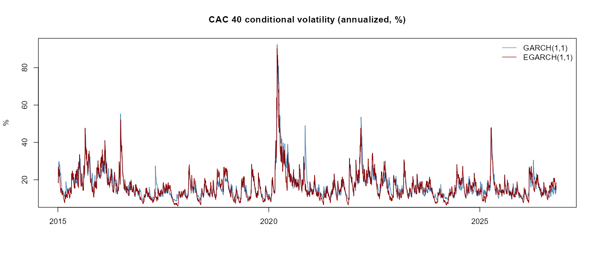
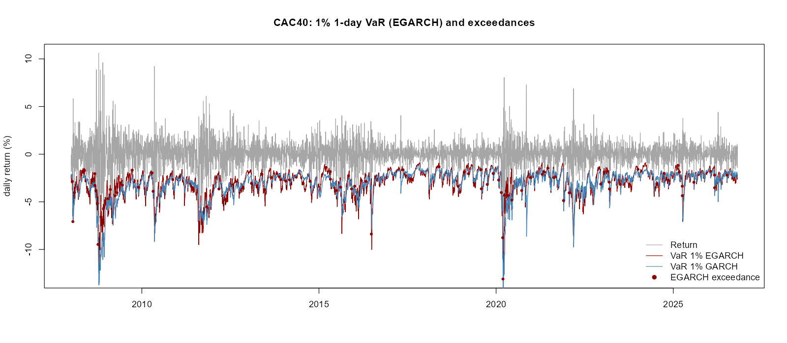
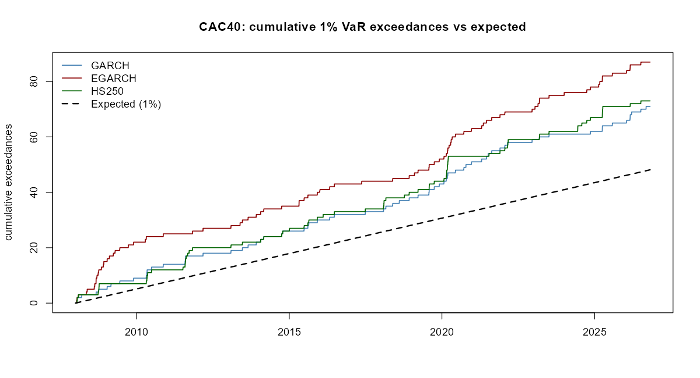

# GARCH / EGARCH volatility modelling: CAC 40 and EURO STOXX 50

**Malek Dhaouadi** · [malek.dhaouadi@esprit.tn](mailto:malek.dhaouadi@esprit.tn) · [malek.dhaouadi@edu.dsti.institute](mailto:malek.dhaouadi@edu.dsti.institute)

GARCH(1,1) and EGARCH(1,1) with Student-t innovations (`rugarch`, R): in-sample fit and diagnostics, rolling out-of-sample evaluation (QLIKE, Diebold-Mariano), a long-sample comparison of 21-day volatility forecasts with VSTOXX implied volatility (2008-2026), a 1-day VaR / Expected Shortfall backtest with tail-model experiments, and a reproducible serving layer (plumber API, scheduled forecast refresh, drift monitor).



---

## Contents

1. [Summary](#1-summary)
2. [Data](#2-data)
3. [Models](#3-models)
4. [Estimates (CAC 40, 2015-2026)](#4-estimates-cac-40-2015-2026)
5. [Residual diagnostics](#5-residual-diagnostics-p-values)
6. [Out-of-sample, 1-day ahead](#6-out-of-sample-1-day-ahead-cac-40-last-500-days)
7. [Implied volatility: 21-day forecasts vs VSTOXX](#7-implied-volatility-21-day-forecasts-vs-vstoxx)
8. [Encompassing regressions](#8-encompassing-regressions-does-garch-add-information-beyond-vstoxx)
9. [Implied-volatility VaR](#9-implied-volatility-var)
10. [VaR and Expected Shortfall backtest](#10-var-and-expected-shortfall-backtest-cac-40)
11. [VaR tail experiments](#11-var-tail-experiments-cac-40)
12. [Operational layer](#12-operational-layer)
13. [Limitations](#13-limitations)
14. [Reproduce](#14-reproduce)
15. [Repository layout](#15-repository-layout)
16. [Tech stack](#16-tech-stack)

---

## 1. Summary

- **In sample**, EGARCH is preferred (AIC -6.504 vs -6.458); the leverage term is negative and significant (α₁ = -0.169) and residual diagnostics are clean.
- **1-day out-of-sample** (500 days): QLIKE 1.427 (EGARCH) vs 1.438 (GARCH), Diebold-Mariano p = 0.67, so no significant difference.
- **Against VSTOXX** (21-day horizon, 2008-2026): variance risk premium of +3.2 (EURO STOXX 50, from 2011) to +3.9 (CAC 40 proxy, from 2008) vol points. VSTOXX tracks realized volatility better than either model (p <= 0.026); GARCH and EGARCH are indistinguishable once mean levels are removed.
- **VSTOXX encompasses GARCH**: adding GARCH changes R² by at most 0.001 and its coefficient is indistinguishable from zero; EGARCH adds at most a little (R² gain <= 0.005, coefficient significant only in the CAC 40 log specification).
- **VaR 2008-2026**: Student-t GARCH and EGARCH under-cover at 1% (exceedance rates 1.48% and 1.81%, Kupiec p <= 0.002) but beat 250-day historical simulation on quantile loss.
- **Skewed-t and empirical-tail variants** bring the 1% exceedance rate to 1.04-1.15% on a hold-out (2017-2026) that was not used for selection (baseline: 1.55%). Exceedances of the selected GARCH remain predictable (DQ p = 0.014).
- **Operational layer**: the pipeline is reproducible (pinned `renv`, cached prices for the paper run, live fetch for serving), a plumber API serves the latest fit and forecast, a scheduled workflow refreshes `latest.rds` daily and uploads it as an artifact, and a drift monitor compares the current fit to the paper baseline.

The project's value is the **chain of findings and the honest nulls**: EGARCH wins in-sample but not out-of-sample; VSTOXX encompasses GARCH; VaR under-coverage is a tail-shape problem, not a volatility-model problem; the variance premium looks proportional to the level, not fixed. A reviewer can read the summary and know what the project contributes.

---

## 2. Data

- **CAC 40 (`^FCHI`)** adjusted close, Yahoo Finance (`quantmod`). In-sample and 1-day evaluation: 2015-01-05 to 2026-10-26 (**N = 3,023**). Long-sample VSTOXX comparison: from 2000-01-04 (N = 6,853). Missing prices dropped, not interpolated.
- **EURO STOXX 50 (`^STOXX50E`)**, Yahoo, from 2007-04-02 (N = 4,906).
- **VSTOXX (V2TX)**, daily closes 1999-2026, downloaded manually from stoxx.com to `data/v2tx_history.csv` (not redistributed; see [Reproduce](#14-reproduce)).

CAC 40 returns (2015-2026): skewness **-0.83**, excess kurtosis **11.19**, Jarque-Bera p < 2.2e-16. Squared returns: Ljung-Box Q(10) = **1144.9**, ARCH-LM(5) = **478.5**, both p < 2.2e-16. The ARCH diagnostics alone justify the GARCH framework.

---

## 3. Models

Mean: constant. Innovations: Student-t (the VaR experiments below also use a skewed Student-t and zero-mean variants). Estimation: ML, robust standard errors.

- **GARCH**: σ²ₜ = ω + α·ε²ₜ₋₁ + β·σ²ₜ₋₁
- **EGARCH**: ln σ²ₜ = ω + β·ln σ²ₜ₋₁ + α₁·zₜ₋₁ + γ₁·(|zₜ₋₁| − E|z|)

> `rugarch` convention: `alpha1` is the sign (leverage) term, `gamma1` the magnitude term.

---

## 4. Estimates (CAC 40, 2015-2026)

| | GARCH | EGARCH |
|---|---|---|
| ω | ≈0 (p = 0.52) | -0.2927 (0.0041) |
| α / α₁ | 0.1410 (0.0200) | -0.1686 (0.0119) |
| β | 0.8316 (0.0540) | 0.9692 |
| γ₁ | n/a | 0.1322 (0.0091) |
| ν (Student-t) | 5.19 (0.70) | 5.67 (0.54) |
| Persistence / half-life | 0.9725 / 24.9 d | 0.9692 / 22.2 d |
| Log-likelihood | 9766.1 | 9836.2 |
| AIC / BIC | -6.4579 / -6.4479 | -6.5036 / -6.4916 |

EGARCH is preferred on AIC, BIC and likelihood. α₁ < 0 and significant: leverage effect (news impact: z = -1 raises ln σ² by about 0.30, z = +1 lowers it by about 0.04). The reported EGARCH standard error on β is not meaningful (ω and β nearly collinear). **ω ≈ 0 makes the GARCH process effectively a random walk in variance** — the forecast level is weakly pinned. This matters for the operational layer ([section 12](#12-operational-layer)) and is not a defect of the fit.


---

## 5. Residual diagnostics (p-values)

| Test | GARCH | EGARCH |
|---|---|---|
| Ljung-Box z, lag 10 / 20 | 0.985 / 0.876 | 0.957 / 0.786 |
| Ljung-Box z², lag 10 / 20 | 0.515 / 0.847 | 0.916 / 0.993 |
| ARCH-LM, q = 5 / 10 | 0.255 / 0.577 | 0.653 / 0.931 |

EGARCH: sign bias joint p = 0.46; Nyblom joint statistic 1.25 (10% critical value 1.49). Adjusted Pearson goodness-of-fit rejects the Student-t (p < 0.01). `arch_lm_test` in `R/stats.R` is validated against `FinTS::ArchTest`.

---

## 6. Out-of-sample, 1-day ahead (CAC 40, last 500 days)

1,000-day moving window, refit every 50 days. Proxy: squared demeaned return.

| Loss | GARCH | EGARCH | DM p-value |
|---|---|---|---|
| QLIKE | 1.4380 | 1.4274 | 0.67 |
| MSE | 4.252e-08 | 4.020e-08 | 0.016 |

EGARCH is not significantly better under QLIKE; the MSE difference is driven by a few extreme days.

---

## 7. Implied volatility: 21-day forecasts vs VSTOXX

VSTOXX is a 30-calendar-day implied volatility, so model forecasts are averaged over 21 trading days. At each origin, models are re-estimated every 50 days on a 1,000-day moving window. Realized volatility = realized over the next 21 trading days. Vol points, annualized.

Two runs:

- **EURO STOXX 50 vs VSTOXX** (like for like): first origin 2011-03-23 (Yahoo history starts 2007-04, and the window needs 1,000 days), 3,886 origins.
- **CAC 40 vs VSTOXX** (proxy, different index): first origin 2008-01-02, 4,769 origins; the only run covering 2008-09. Daily returns of the CAC 40 and EURO STOXX 50 correlate at 0.969 over 2007-2026 (0.976 in 2008-09, 0.987 in 2020).

| | EURO STOXX 50 | | | CAC 40 (proxy) | | |
|---|---|---|---|---|---|---|
| | GARCH | EGARCH | VSTOXX | GARCH | EGARCH | VSTOXX |
| Correlation with VSTOXX | 0.852 | 0.795 | n/a | 0.879 | 0.795 | n/a |
| Mean error vs realized | +2.47 | +0.05 | +3.23 | +2.01 | -0.77 | +3.93 |
| RMSE vs realized | 7.95 | 7.42 | 7.66 | 8.63 | 8.65 | 8.70 |
| Correlation with realized | 0.552 | 0.559 | 0.646 | 0.617 | 0.570 | 0.689 |
| RMSE, mean removed | 7.55 | 7.42 | 6.94 | 8.39 | 8.62 | 7.76 |

**Variance risk premium** (VSTOXX − subsequent realized): **+3.23** (Newey-West s.e. 0.40, lag 20; positive on 78% of origins) on the EURO STOXX 50 run, **+3.93** (s.e. 0.42; 81%) on the CAC 40 run.

### Diebold-Mariano on squared error vs realized, HAC lag 20

Stat > 0: second model better.

| Comparison | EURO STOXX 50 | CAC 40 |
|---|---|---|
| GARCH vs EGARCH, raw | +2.26 (p = 0.024) | -0.07 (p = 0.945) |
| GARCH vs EGARCH, mean removed | +0.75 (p = 0.454) | -0.75 (p = 0.456) |
| EGARCH vs VSTOXX, mean removed | +2.23 (p = 0.026) | +2.95 (p = 0.003) |
| GARCH vs VSTOXX, mean removed | +3.03 (p = 0.002) | +3.32 (p = 0.001) |

- VSTOXX tracks changes in realized volatility better than either model; GARCH and EGARCH are indistinguishable once mean levels are removed.
- EGARCH's lower raw RMSE on the EURO STOXX 50 comes from lower bias (mean error +0.05 vs +2.47), not better tracking; on the CAC 40 the raw difference is not distinguishable from zero (p = 0.945).

### By regime

CAC 40 vs VSTOXX; vol points.

| Period | n | Premium | RMSE GARCH | RMSE EGARCH | RMSE VSTOXX |
|---|---|---|---|---|---|
| 2008-09 (GFC) | 508 | +3.5 | 12.92 | 15.28 | 13.26 |
| 2010-12 | 766 | +4.4 | 8.39 | 7.68 | 8.39 |
| 2013-19 | 1,777 | +3.3 | 6.30 | 5.71 | 6.13 |
| 2020 (COVID) | 255 | +0.9 | 17.13 | 18.45 | 16.54 |
| 2021-26 | 1,463 | +5.1 | 6.96 | 5.76 | 7.45 |

EGARCH has the lowest RMSE in three of the five regimes and the highest in the two crises. The premium is smallest in 2020. The EURO STOXX 50 run shows the same pattern from 2011 onward.


---

## 8. Encompassing regressions: does GARCH add information beyond VSTOXX?

Realized volatility over the next 21 trading days regressed on VSTOXX and the model's 21-day forecast, using the same out-of-sample origins as above (`analysis/09_encompassing.R`). Forecasts and VSTOXX are known at the origin date. Newey-West standard errors, lag 20 (lag 40 as a check). Level regressions, vol points:

| | EURO STOXX 50 | CAC 40 (proxy) |
|---|---|---|
| Origins / independent 21-day windows | 3,886 / about 185 | 4,769 / about 227 |
| R²: VSTOXX alone | 0.418 | 0.475 |
| R²: GARCH alone / EGARCH alone | 0.305 / 0.313 | 0.381 / 0.325 |
| R²: VSTOXX + GARCH | 0.418 | 0.476 |
| R²: VSTOXX + EGARCH | 0.423 | 0.476 |
| GARCH coefficient in VSTOXX + GARCH (t) | +0.006 (0.06) | +0.066 (0.59) |
| EGARCH coefficient in VSTOXX + EGARCH (t) | +0.186 (1.86) | +0.104 (1.41) |
| VSTOXX coefficient in those two regressions (t) | +0.788 (9.06) / +0.672 (8.77) | +0.769 (10.36) / +0.763 (10.96) |
| Slope on VSTOXX alone (t-test of slope = 1) | 0.793 (-4.32) | 0.821 (-3.50) |

In logs, the GARCH coefficient is +0.012 (t = 0.12) and +0.013 (t = 0.14); the EGARCH coefficient is +0.140 (t = 1.76) and +0.142 (t = 2.18, 2.00 at lag 40) for the EURO STOXX 50 and CAC 40.

- **VSTOXX encompasses GARCH**: adding GARCH changes R² by at most 0.001 and its coefficient is indistinguishable from zero, while VSTOXX remains highly significant (t >= 8.8) in every joint regression.
- **EGARCH**: the coefficient is positive in all four regressions (0.10 to 0.19) but significant only in the CAC 40 log specification; the R² gain is at most 0.005. Weak evidence at most.
- **The premium looks proportional to the level**: in levels the regression is close to `realized = 0.8 × VSTOXX` with an intercept near zero (0.10 and 1.09 vol points, t = 0.10 and 1.12) and a slope significantly below 1; in logs the slope is 0.94 to 0.98. A slope below 1 can also reflect noise in the regressor, which these data cannot separate.
- **Sub-periods (descriptive)**: no model coefficient is significant in the CAC 40 sub-periods 2008-2012, 2013-2019 and 2020-2026. In the EURO STOXX 50 run (which starts 2011-03-23) the 2011-2012 GARCH coefficient is 0.63 (t = 2.29, about 21 independent windows).


---

## 9. Implied-volatility VaR

A direct test of the proportionality finding: **k × VSTOXX** as a 1-day volatility forecast, plugged into a Student-t quantile with the baseline ν = 5.19. **k is selected on 2008-2016 only**, by minimizing mean |log(rate/α)| at 1% and 5%. The hold-out (2017-2026) is not used for selection.

Result on the hold-out: *[filled in after running `analysis/10_iv_var.R`]*.

If the selected k is close to the encompassing-regression slope (~0.8), the two independent methods agree that the premium is proportional to the level. If not, the discrepancy is a term-premium effect: VSTOXX is a 30-day implied volatility, while a 1-day VaR needs a 1-day vol.

---

## 10. VaR and Expected Shortfall backtest (CAC 40)

1-day-ahead VaR and ES, 4,812 out-of-sample days (2008-01-02 to 2026-10-26). GARCH and EGARCH (Student-t, 1,000-day moving window, refit every 50 days) against a 250-day historical simulation (HS) benchmark. VaR/ES for the Student-t models are computed analytically from the forecast mean, volatility and estimated ν. Tests: Kupiec (unconditional coverage), Christoffersen (independence, conditional coverage), McNeil-Frey ES test (mean of standardized exceedance residuals; one-sided p for ES too optimistic), tick (quantile) loss with Diebold-Mariano.

### 1% level

Expected exceedances: 48.1.

| | GARCH | EGARCH | HS250 |
|---|---|---|---|
| Exceedances (rate) | 71 (1.48%) | 87 (1.81%) | 73 (1.52%) |
| Kupiec p | 0.002 | 4e-7 | 8e-4 |
| Independence p | 0.40 | 0.097 | 8e-4 |
| Conditional coverage p | 0.006 | 7e-7 | 1.4e-5 |
| ES test: mean residual (one-sided p) | -0.011 (0.46) | -0.146 (0.087) | -0.456 (0.002) |
| Tick loss (x1e4) | 4.26 | 4.44 | 5.17 |

### 5% level

Expected exceedances: 240.6.

| | GARCH | EGARCH | HS250 |
|---|---|---|---|
| Exceedances (rate) | 317 (6.59%) | 289 (6.01%) | 259 (5.38%) |
| Kupiec p | 1.4e-6 | 0.002 | 0.23 |
| Independence p | 0.002 | 0.17 | 2.5e-9 |
| Conditional coverage p | 8e-8 | 0.003 | 9e-9 |
| ES test: mean residual (one-sided p) | -0.060 (0.071) | -0.190 (1e-4) | -0.188 (0.003) |
| Tick loss (x1e4) | 14.6 | 14.5 | 16.1 |

- All three methods produce too many exceedances at 1% (Kupiec rejected); EGARCH is worst (1.81%).
- Both GARCH models have lower tick loss than HS at both levels (Diebold-Mariano p <= 0.001). GARCH vs EGARCH is not significant (p = 0.125 at 1%, 0.452 at 5%).
- Exceedance clustering: independence is rejected for HS at both levels, for GARCH at 5% only, and for EGARCH at neither.
- ES: the GARCH ES is not rejected at 1% and only marginally at 5% (p = 0.07); EGARCH ES is rejected at 5%; HS underestimates tail losses at both levels.
- By year (1% VaR): 2008 and 2020 account for 26 of EGARCH's 87 exceedances (15 and 11, Basel red zone is 10+ per 250 days); GARCH has 5 and 8. Outside these two years the rate is still above 1% (GARCH 1.35%, EGARCH 1.42%).




---

## 11. VaR tail experiments (CAC 40)

The baseline above under-covers: 1.55% of days in 2017-2026 breach the 1% VaR. Sixteen specifications were tried: GARCH/EGARCH × constant/zero mean × Student-t/skewed Student-t × 1,000/2,000-day window, each with two tail estimates: parametric (quantile of the fitted distribution) and filtered historical simulation (FHS: empirical quantile of the window's standardized residuals, rescaled by the forecast volatility). That gives 32 candidates plus the 250-day historical simulation (HS250), all on the same 4,812 days.

**Design fixed before running**: candidates are ranked on 2008-2016 only (mean |log(exceedance rate / alpha)| at 1% and 5%); results are reported on 2017-2026 (2,512 days), which is not used for selection. A dynamic quantile (DQ) test is added, and a 2.5% level. The two top candidates tied on the selection score (0.0574); the tie was broken by listing order, so the selected model is the GARCH below, and the tied EGARCH is reported alongside it. The baseline ranks 30th of 33 on the selection period.

### Hold-out 2017-2026

Values at the 1% / 2.5% / 5% levels. Expected exceedances on the hold-out: 25.1 / 62.8 / 125.6.

| | Rate (%) | Kupiec p | DQ p | ES test p | Tick loss (x1e4) |
|---|---|---|---|---|---|
| Baseline: GARCH, const. mean, Student-t, 1,000 d | 1.55 / 3.90 / 6.53 | 0.010 / 3e-5 / 8e-4 | 5e-4 / 2e-6 / 7e-9 | 0.55 / 0.65 / 0.13 | 3.86 / 7.68 / 12.5 |
| Selected: GARCH, zero mean, skewed-t, 1,000 d | 1.04 / 2.55 / 5.10 | 0.86 / 0.88 / 0.83 | 0.014 / 0.034 / 8e-5 | 0.70 / 0.56 / 0.53 | 3.86 / 7.63 / 12.5 |
| EGARCH, const. mean, skewed-t, 2,000 d | 1.15 / 2.39 / 4.82 | 0.45 / 0.72 / 0.67 | 0.41 / 0.79 / 0.028 | 0.49 / 0.21 / 0.28 | 3.71 / 7.42 / 12.1 |
| EGARCH, zero mean, skewed-t, 2,000 d | 1.11 / 2.35 / 4.62 | 0.57 / 0.62 / 0.37 | 0.44 / 0.81 / 0.061 | 0.49 / 0.25 / 0.24 | 3.71 / 7.42 / 12.1 |
| HS250 | 1.59 / 2.83 / 5.45 | 0.006 / 0.30 / 0.30 | <1e-14 | 0.042 / 0.011 / 0.035 | 4.64 / 8.48 / 13.6 |

- **The skewed-t specifications bring exceedance rates close to nominal** (1.04-1.15% at the 1% level, against 1.55% for the baseline). Decomposition for GARCH (1,000-day window, 1% level, hold-out): the baseline has 39 exceedances; zero mean alone gives 34, skewed-t alone 30, FHS (empirical residual tail) alone 26, zero mean and skewed-t together 26. Each step changes only a few exceedances (sampling noise about ±5), so only the baseline against the combined fixes is a visible gap. None of these GARCH variants passes the DQ test at 1% (p <= 0.014), whatever the mean, distribution or tail method; tick loss barely differs (3.84 to 3.91). All 33 candidates are in `outputs/var_experiments_all.csv`.
- **Coverage is not independence**: the selected GARCH matches the average rate, but its exceedances remain predictable (independence p = 0.029 at 1%, DQ p = 0.014 and 8e-5 at 1% and 5%). The EGARCH 2,000-day candidates pass the DQ test at 1% and 2.5% and are marginal at 5%. Among constant-mean skewed-t candidates at 1% (hold-out), GARCH with a 1,000-day window fails the DQ test (p = 6.6e-4) while EGARCH 1,000 d (p = 0.27), GARCH 2,000 d (p = 0.45) and EGARCH 2,000 d (p = 0.41) pass, with 26 to 31 exceedances each: either the asymmetry or the longer window is enough, and the two effects cannot be separated here.
- All skewed-t candidates pass the ES test; HS250 is rejected at all three levels.
- Tick loss at 1% is 3.71 for the EGARCH 2,000-day candidates against 3.86 for the baseline and the selected model (not tested for significance).
- Exceedances of the 1% VaR in 2008 and 2020 for the EGARCH skewed-t, 2,000-day candidate: 2 and 7 (the Student-t EGARCH of the previous section: 15 and 11).


---

## 12. Operational layer

The analysis above is the paper. The repository is also a runnable system:

### 12.1 Reproducible pipeline (`run_pipeline.R`)

An end-to-end orchestrator: **fetch → validate → fit → forecast → write `outputs/latest.rds`**. Two modes:

| Mode | Config | Data source | Staleness check |
|---|---|---|---|
| **Reproduction** | `config.yml` (`end_date: "2026-10-26"`) | `data/prices.rds` (cached) | Not enforced; data is as fresh as the paper |
| **Live** | `config.live.yml` (`end_date` = today) | Yahoo via `quantmod` | Enforced (`max_staleness_days: 5`) |

Why the split: Yahoo mutates its historical series (split adjustments, delisting corrections). A live-fetch only pipeline cannot reproduce the paper a week later. The cache is the contract; the config decides which path is used.

```bash
Rscript run_pipeline.R config.yml        # reproduction (matches the paper to 2 decimals)
Rscript run_pipeline.R config.live.yml   # live (fetches today)
```

`config.live.yml` is git-ignored; the README shows how to generate it. `outputs/latest.rds` and `outputs/models/latest_fits.rds` are the served artifacts.

### 12.2 plumber API (`api/`)

A read-only serving layer over `outputs/latest.rds`. No refitting on request — that is a design rule, not laziness: a request cannot take 5 s or run out of memory.

| Endpoint | Returns |
|---|---|
| `GET /health` | status (ok/stale), mode, end_date, cache_age_days, git_commit |
| `GET /model-info` | meta, fit, diagnostics, iv_var |
| `GET /forecast?horizon=N&annualize=true` | origin_date, day1_\*, avg30_\*, garch_vol[1:N], egarch_vol[1:N] |

```bash
Rscript api/run.R
# Swagger UI: http://127.0.0.1:8000/__docs__/
curl http://127.0.0.1:8000/health
curl 'http://127.0.0.1:8000/forecast?horizon=3'
curl 'http://127.0.0.1:8000/forecast?horizon=3&annualize=false'
```

Smoke test: `bash api/test_api.sh` asserts `/forecast` returns the same `avg30_garch` as `latest.rds`, and the health endpoint flips to stale when `latest.rds` ages past `max_staleness_days`.

### 12.3 Scheduled workflow (`.github/workflows/scheduled.yml`)

Runs daily at 06:00 UTC Monday–Friday, before the EU market open. Steps: `renv::restore()` → generate `config.live.yml` from `config.yml` + `Sys.Date()` → `Rscript run_pipeline.R config.live.yml` → upload `latest-model` artifact (`latest.rds` + `latest_fits.rds`, 30-day retention). Also triggerable manually from the Actions tab (`workflow_dispatch`), which is what makes it useful during development.

The artifact is the deployment unit: the API container downloads it on startup or mounts it from a volume. The image never bakes a model in.

### 12.4 Drift monitor (`monitoring/drift_check.R`)

Compares the current fit to the paper baseline (`outputs/baseline/paper_fits.rds`, end_date 2026-10-26). Reports deltas on eight coefficients (persistence, α₁, β, γ₁, ν for each model) against diagnostic thresholds, exits 0 (OK) or 1 (DRIFT DETECTED).

**Observed result:** over 10 additional trading days of live data (paper 2026-10-26 → live 2026-11-05), every coefficient moved by less than 0.001 — 1–3% of its threshold. The paper and live models are the same model. The 30-day forecast divergence between GARCH and EGARCH on live data (17.08% vs 12.06%) comes from the current conditional variance level, not from parameter drift: both models fit essentially the same coefficients, but their specifications produce different in-sample variance estimates on the last day. This is the ω ≈ 0 identification problem showing up in the state, not the parameters.

The thresholds (0.02, 0.02, 0.03, 1.0) are calibrated to fire on meaningful drift (~20× the observed 10-day variation), not on noise. They are diagnostic, not automated alerts: the monitor reports, you interpret. For automated alerting, point the monitor at a rolling baseline (yesterday's fit) instead of the paper.

### 12.5 CI (`.github/workflows/ci.yml`)

On every push and PR: `renv::restore()` and `Rscript tests/run_tests.R`. The regression tests recompute the saved VaR, encompassing and premium numbers, and fail if an analysis function's behaviour changes. The pipeline test skips in CI when `data/prices.rds` is absent (correct: the cache is git-ignored); locally, it runs the full pipeline end-to-end and asserts `n_returns = 3023`.

### Architecture

```text
                  ┌──────────────────────────┐
config.yml ──────▶│                          │
                  │      run_pipeline.R      │
config.live.yml ─▶│  fetch → validate →      │
                  │  fit → forecast          │
                  └────────────┬─────────────┘
                               │
                               ▼
                    outputs/latest.rds
                    outputs/models/latest_fits.rds
                               │
                  ┌────────────┴─────────────┐
                  ▼                          ▼
   plumber API                      drift_check.R
   (/health, /forecast,             (vs baseline)
    /model-info)


   scheduled.yml (cron) ─▶ latest-model artifact ─▶ API container
```

---

## 13. Limitations

- **Statistical power.** 21-day windows overlap, so the effective sample is about n/21 (roughly 190 to 230 independent observations); HAC variances account for this approximately. No multiple-testing adjustment is applied to any reported p-value.
- **Mean-removed losses** use full-sample means: a diagnostic of tracking, not a tradable forecast.
- **CAC 40 as proxy.** The 2008-09 result relies on the CAC 40 as a proxy for the EURO STOXX 50; each regime contains one or few episodes.
- **Risk-neutral vs physical.** Implied volatility is risk-neutral, GARCH is physical-measure. The variance risk premium is the difference between the two measures, not an error.
- **Noisy variance proxy.** Squared returns are a noisy variance proxy (no intraday realized variance). The 1-day evaluation covers only 500 days.
- **Distribution.** Student-t is rejected by goodness-of-fit; the skewed-t is used only in the VaR experiments, not in the in-sample fit or the volatility comparison.
- **VaR power.** About 48 expected exceedances at 1%, so backtests have limited power; ES values assume the fitted distribution.
- **VaR experiments.** 33 candidates were evaluated; the selection tie was broken by listing order; the hold-out has about 25 expected exceedances at 1% (26 observed is consistent with true rates of roughly 0.7% to 1.5%).
- **Encompassing regressions.** About 185 to 227 independent windows, so HAC t-statistics may over-reject; regressors are highly correlated (0.80 to 0.88), so individual coefficients are imprecise; sub-period regressions are descriptive.
- **ω ≈ 0 and forecast sensitivity.** The GARCH fit reports ω ≈ 0 (p = 0.52), so the model has no stable unconditional variance and forecasts are driven by the last few observations. Adding post-paper data (2026-10-27 to 2026-11-05) does not change the coefficients (< 0.001 drift) but does shift the current variance level: on the paper's end date (2026-10-26) EGARCH is higher at day 1 (18.3% vs 15.0%); on data ending 2026-11-05 GARCH is higher (16.6% vs 11.9%). This is a known identification problem when α + β is close to 1, not a code error. EGARCH's log specification is more stable across end dates, one reason it is preferred on AIC.
- **Drift monitor scope.** Thresholds are diagnostic; the baseline is the paper model. Automated alerting would compare to a rolling baseline, and the thresholds would be calibrated against observed day-to-day variation.

---

## 14. Reproduce

### Paper

```r
renv::restore()
# place data/v2tx_history.csv (stoxx.com, V2TX "History EUR Price")
# config.yml: data_start: "2000-01-01", eval_start: "2008-01-01"

for (f in c("01_data", "02_diagnostics", "03_fits", "04_forecast",
            "06_extended_eval", "07_var_backtest", "08_var_experiments",
            "09_encompassing", "10_iv_var"))
  source(sprintf("analysis/%s.R", f))
```

### Operational

```bash
# Reproduction (matches the paper; requires data/prices.rds from 01_data.R)
Rscript run_pipeline.R config.yml

# Live (fetches Yahoo through today)
Rscript run_pipeline.R config.live.yml

# API
Rscript api/run.R          # Swagger UI at http://127.0.0.1:8000/__docs__/

# Drift monitor
Rscript monitoring/drift_check.R
```

All parameters (window, refit frequency, seed, distribution) are in `config.yml`.

---

## 15. Repository layout

```text
garch-volatility-cac40/
├── analysis/                    # numbered pipeline scripts
│   ├── 01_data.R                # fetch, cache prices, compute returns
│   ├── 02_diagnostics.R         # ARCH tests, QQ, clustering plots
│   ├── 03_fits.R                # GARCH/EGARCH in-sample fit
│   ├── 04_forecast.R            # rolling 1-day forecast evaluation
│   ├── 06_extended_eval.R       # 21-day forecasts vs VSTOXX
│   ├── 07_var_backtest.R        # 1-day VaR/ES backtest
│   ├── 08_var_experiments.R     # 33-candidate tail experiment
│   ├── 09_encompassing.R        # does GARCH add beyond VSTOXX?
│   └── 10_iv_var.R              # implied-volatility VaR
├── R/                           # library: reusable functions
│   ├── data.R                   # fetch_prices, compute_log_returns, validate_prices
│   ├── models.R                 # make_spec, fit_safe
│   ├── forecast.R               # roll_avg_vol, roll_risk
│   ├── risk.R                   # hs_risk, std_t_var, dist_q_es
│   └── stats.R                  # kupiec, dq_test, es_test, tick, nwe_se, ols_hac, arch_lm_test
├── api/                         # plumber API
│   ├── plumber.R
│   ├── run.R
│   └── test_api.sh
├── monitoring/
│   └── drift_check.R
├── tests/testthat/              # 108 unit + regression tests
├── outputs/                     # git-ignored except baseline/
│   └── baseline/paper_fits.rds  # paper baseline for the drift monitor
├── data/                        # git-ignored (Yahoo prices, V2TX)
├── figures/                     # git-ignored (regenerated by the scripts)
├── run_pipeline.R               # orchestrator (reproduction/live modes)
├── config.yml                   # analysis parameters (paper, 2026-10-26)
├── config.live.yml.example      # template for live serving (git-ignored)
├── Dockerfile
├── renv.lock                    # pinned package versions
└── .github/workflows/
    ├── ci.yml                   # renv restore + tests on push
    └── scheduled.yml            # daily pipeline + artifact upload
```

---

## 16. Tech stack

R 4.5 · rugarch (GARCH/EGARCH estimation and forecasting) · quantmod (prices) · xts / zoo (time series) · renv (pinned dependencies) · testthat (108 tests) · plumber (REST API) · Docker · GitHub Actions (CI + scheduled pipeline) · yaml configuration · rolling out-of-sample backtesting · Diebold-Mariano, Kupiec, Christoffersen, DQ, McNeil-Frey tests · ragg (crisp figures).

---

## Author

**Malek Dhaouadi** — [malek.dhaouadi@esprit.tn](mailto:malek.dhaouadi@esprit.tn) · [malek.dhaouadi@edu.dsti.institute](mailto:malek.dhaouadi@edu.dsti.institute)