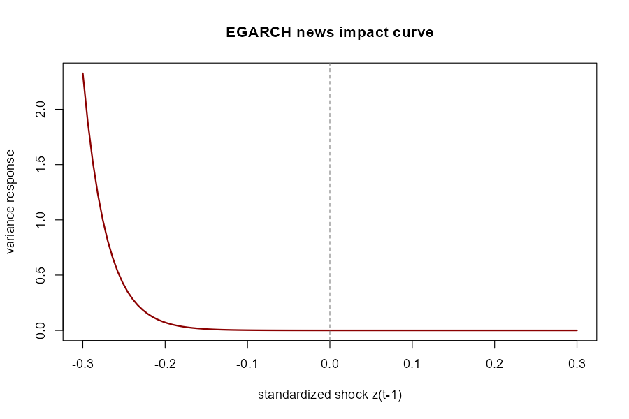
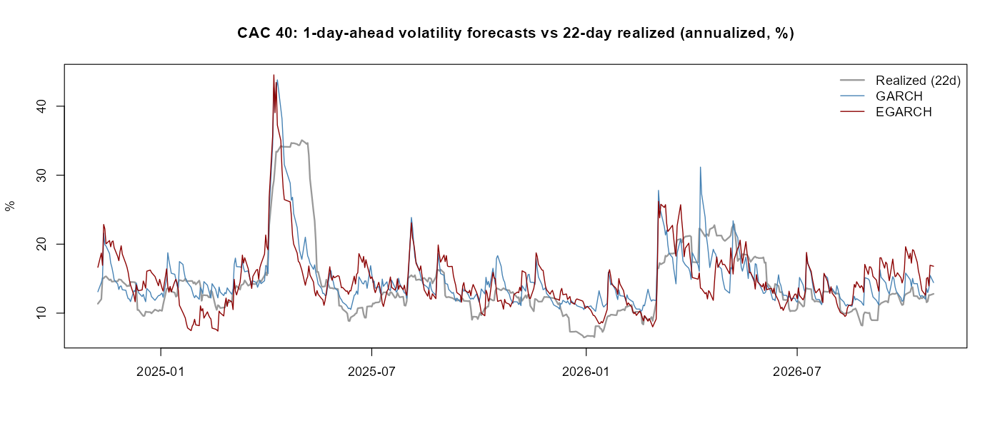
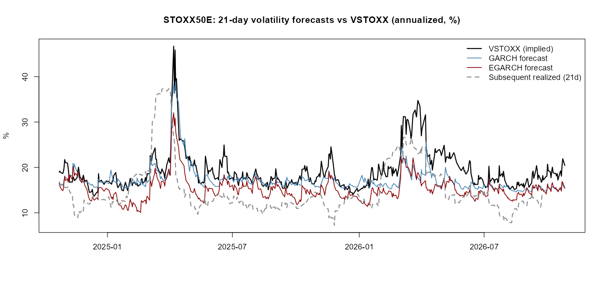

# GARCH / EGARCH volatility modelling: CAC 40 and EURO STOXX 50

GARCH(1,1) and EGARCH(1,1) with Student-t innovations (`rugarch`, R): in-sample fit and diagnostics, rolling out-of-sample evaluation (QLIKE, Diebold-Mariano), and comparison of 21-day volatility forecasts with VSTOXX implied volatility.


## Data

- CAC 40 (`^FCHI`) adjusted close, Yahoo Finance (`quantmod`). 2015-01-05 to 2026-10-26, N = 3,023 daily log returns. One NA price (2019-12-25) dropped, not interpolated.
- EURO STOXX 50 (`^STOXX50E`), same pipeline, used for the implied volatility comparison.
- VSTOXX (V2TX), daily closes, downloaded manually from stoxx.com to `data/v2tx_history.csv`.

Returns: skewness -0.83, excess kurtosis 11.19, Jarque-Bera p < 2.2e-16. Squared returns: Ljung-Box Q(10) = 1144.9, ARCH-LM(5) = 478.5, both p < 2.2e-16.

## Models

Mean: constant. Innovations: Student-t. Estimation: ML, robust standard errors.

- GARCH: σ²ₜ = ω + α·ε²ₜ₋₁ + β·σ²ₜ₋₁
- EGARCH: ln σ²ₜ = ω + β·ln σ²ₜ₋₁ + α₁·zₜ₋₁ + γ₁·(|zₜ₋₁| − E|z|)

`rugarch` convention: `alpha1` is the sign (leverage) term, `gamma1` the magnitude term.

## Estimates (CAC 40)

| | GARCH | EGARCH |
|---|---|---|
| ω | ≈0 (p = 0.52) | -0.2927 (0.0041) |
| α / α₁ | 0.1410 (0.0200) | -0.1686 (0.0119) |
| β | 0.8316 (0.0540) | 0.9692 |
| γ₁ | n/a | 0.1322 (0.0091) |
| ν (Student-t) | 5.19 (0.70) | 5.67 (0.54) |
| Persistence / half-life | 0.9725 / 24.9 d | 0.9692 / 22.2 d |
| Log-likelihood | 9766.1 | 9836.2 |
| AIC / BIC | -6.4579 / -6.4479 | -6.5036 / -6.4916 |

EGARCH is preferred on AIC, BIC and likelihood. α₁ < 0 and significant: leverage effect (news impact: z = -1 raises ln σ² by about 0.30, z = +1 lowers it by about 0.04). The reported EGARCH standard error on β is not meaningful (ω and β nearly collinear).



## Residual diagnostics (p-values)

| Test | GARCH | EGARCH |
|---|---|---|
| Ljung-Box z, lag 10 / 20 | 0.985 / 0.876 | 0.957 / 0.786 |
| Ljung-Box z², lag 10 / 20 | 0.515 / 0.847 | 0.916 / 0.993 |
| ARCH-LM, q = 5 / 10 | 0.255 / 0.577 | 0.653 / 0.931 |

EGARCH: sign bias joint p = 0.46; Nyblom joint statistic 1.25 (10% critical value 1.49). Adjusted Pearson goodness-of-fit rejects the Student-t (p < 0.01). `arch_lm_test` in `R/utils.R` is validated against `FinTS::ArchTest`.

## Out-of-sample, 1-day ahead (CAC 40)

500 forecasts, 1,000-day moving window, refit every 50 days. Proxy: squared demeaned return.

| Loss | GARCH | EGARCH | DM p-value |
|---|---|---|---|
| QLIKE | 1.4380 | 1.4274 | 0.67 |
| MSE | 4.252e-08 | 4.020e-08 | 0.016 |

EGARCH is not significantly better under QLIKE; the MSE difference is significant but driven by a few extreme days.



## Implied volatility (EURO STOXX 50 vs VSTOXX)

VSTOXX is the 30-calendar-day implied volatility, so forecasts are averaged over 21 trading days. 501 origins (2024-10-23 to 2026-10-26), same rolling setup. Realized volatility = next 21 trading days (480 origins). Vol points, annualized.

| | GARCH | EGARCH | VSTOXX |
|---|---|---|---|
| Correlation with VSTOXX | 0.72 | 0.82 | n/a |
| Mean (VSTOXX − forecast) | +1.8 | +3.9 | n/a |
| Mean error vs realized | +2.32 | +0.21 | +4.12 |
| RMSE vs realized | 6.21 | 5.50 | 6.80 |
| Correlation with realized | 0.30 | 0.37 | 0.47 |
| RMSE, mean removed | 5.76 | 5.50 | 5.42 |

- Variance risk premium (VSTOXX − subsequent realized): +4.1 points, Newey-West s.e. 0.83 (lag 20), positive on 87% of origins. CAC 40 run against the same VSTOXX series: +5.2 points, 92%.
- After removing the mean level, VSTOXX tracks realized volatility best, then EGARCH, then GARCH.



## Limitations

- Squared returns are a noisy variance proxy; intraday realized variance is not used.
- Implied volatility comparison covers two years; 21-day windows overlap, so differences are descriptive.
- Implied volatility is risk-neutral, GARCH is physical-measure.
- Student-t rejected by goodness-of-fit; skewed-t not tested.

## Reproduce

```r
renv::restore()
# place data/v2tx_history.csv (stoxx.com, V2TX "History EUR Price")
for (f in c("01_data", "02_diagnostics", "03_fits", "04_forecast", "05_implied_vol"))
  source(sprintf("R/%s.R", f))
```

Parameters (window, refit frequency, seed, distribution) are in `config.yml`.