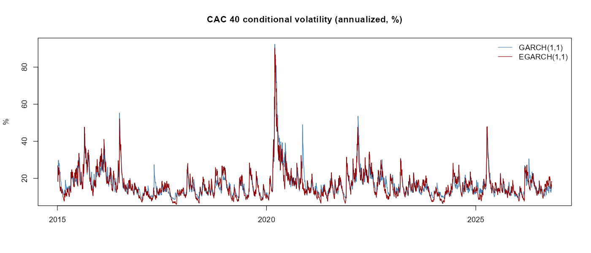
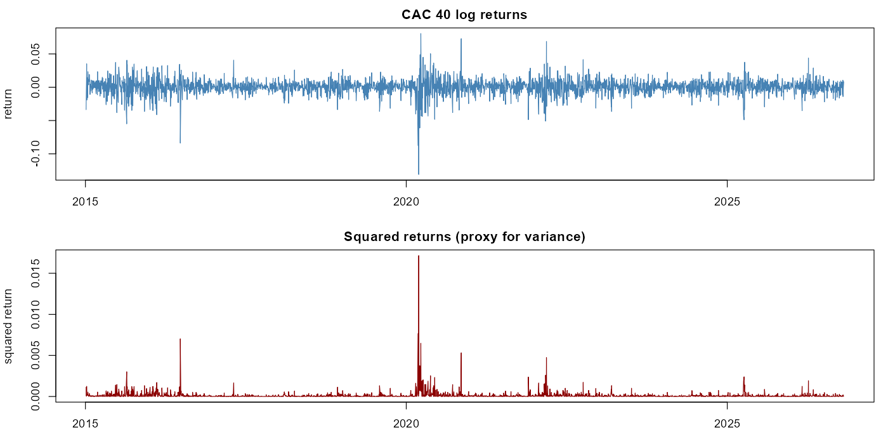
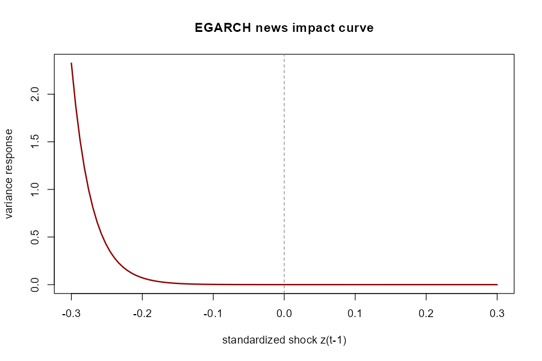
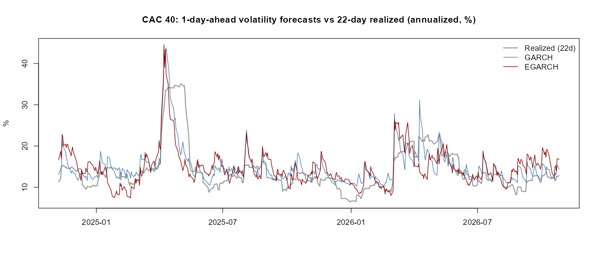
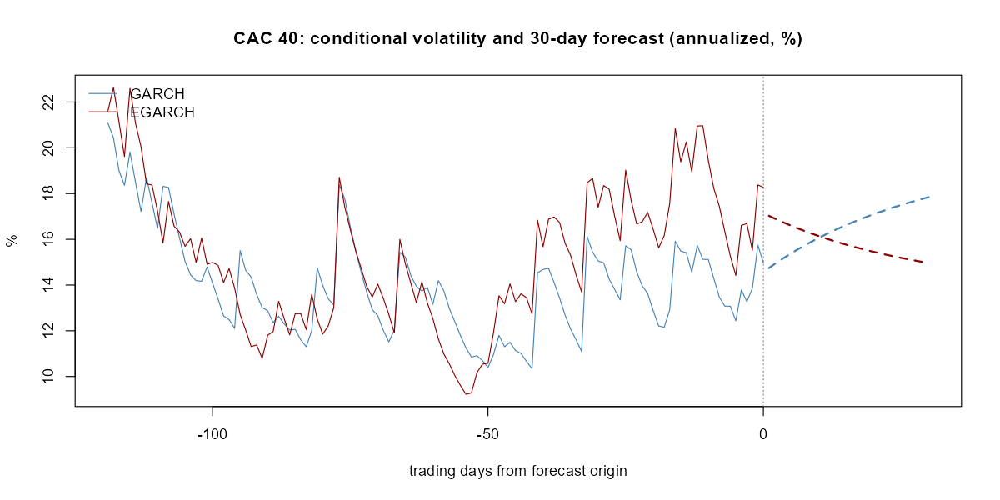

# GARCH / EGARCH volatility modelling of the CAC 40

Conditional volatility modelling of daily CAC 40 returns in R with `rugarch`: model fitting, residual diagnostics, leverage effect, rolling out-of-sample evaluation and a 30-day volatility forecast.



## 1. Data

| | |
|---|---|
| Series | CAC 40 (`^FCHI`), adjusted close, Yahoo Finance via `quantmod` |
| Sample | 2015-01-05 to 2026-10-26 |
| Observations | 3,023 daily log returns |
| Missing data | One NA price (2019-12-25), dropped. Not interpolated, because a non-trading day is not a 0% return |

All settings (index, dates, distribution, forecast horizon, rolling window, refit frequency, seed) live in `config.yml`.

## 2. Stylized facts

| Statistic | Value |
|---|---|
| Mean / SD (daily) | 0.0002 / 0.0115 (about 18.3% annualized) |
| Skewness | -0.83 |
| Excess kurtosis | 11.19 |
| Min / Max | -13.10% / +8.06% |
| Jarque-Bera | p < 2.2e-16 (normality rejected) |
| Ljung-Box on r², lag 10 / 20 / 50 | Q = 1144.9 / 1356.8 / 1520.8, p < 2.2e-16 |
| ARCH-LM on r², q = 5 / 10 | LM = 478.5 / 569.2, p < 2.2e-16 |

Returns are fat-tailed, negatively skewed and show strong volatility clustering, which motivates a GARCH-type model with Student-t innovations.



## 3. Models

Both models use a constant mean and Student-t innovations (`distribution.model = "std"`), estimated by maximum likelihood.

**GARCH(1,1)**

σ²(t) = ω + α·ε²(t-1) + β·σ²(t-1)

**EGARCH(1,1)**, which models log-variance, so no positivity constraints are needed, and allows asymmetric responses:

ln σ²(t) = ω + β·ln σ²(t-1) + α·z(t-1) + γ·(|z(t-1)| − E|z|)

Note on naming: `rugarch` calls the sign (leverage) coefficient `alpha1` and the magnitude coefficient `gamma1`. This is the reverse of some textbook notation. A negative `alpha1` means falls raise volatility more than rises.

## 4. Estimation results

Robust standard errors in parentheses.

| Parameter | GARCH(1,1) | EGARCH(1,1) |
|---|---|---|
| μ | 0.00073 (0.00014) | 0.00041 (0.00014) |
| ω | ~0 (not significant, p = 0.52) | -0.2927 (0.0041) |
| α1 | 0.1410 (0.0200) | -0.1686 (0.0119) |
| β1 | 0.8316 (0.0540) | 0.9692 (0.0001) |
| γ1 | n/a | 0.1322 (0.0091) |
| Student-t shape (ν) | 5.19 (0.70) | 5.67 (0.54) |
| Persistence | α+β = 0.9725 | β = 0.9692 |
| Half-life of a shock | 24.9 days | 22.2 days |
| Log-likelihood | 9766.1 | 9836.2 |
| AIC / BIC (per obs.) | -6.4579 / -6.4479 | -6.5036 / -6.4916 |

- **Leverage effect.** In EGARCH a one-unit negative standardized shock raises log-variance by about 0.30, while a one-unit positive shock lowers it by about 0.04. The market reacts strongly to falls and barely to rises.
- **Model choice.** EGARCH is preferred by AIC, BIC and log-likelihood (+70 log-likelihood points for one extra parameter).
- **Tails.** ν of 5 to 6 degrees of freedom is consistent with the sample excess kurtosis of 11.
- **Long-run volatility.** GARCH implies about 20.0% annualized, but its ω is not significant, so this number is imprecise.
- The extremely small standard error on EGARCH β is an optimizer artifact (ω and β are nearly collinear in the log-variance recursion). The estimate is reliable, the t-statistic is not meaningful.



## 5. Residual diagnostics

p-values on standardized residuals. Values above 0.05 mean no structure is left.

| Test | GARCH | EGARCH |
|---|---|---|
| Ljung-Box on z, lag 10 / 20 | 0.985 / 0.876 | 0.957 / 0.786 |
| Ljung-Box on z², lag 10 / 20 | 0.515 / 0.847 | 0.916 / 0.993 |
| ARCH-LM, q = 5 / 10 | 0.255 / 0.577 | 0.653 / 0.931 |

Additional EGARCH checks from `rugarch`:

- Sign bias test (joint): p = 0.46, so the asymmetry is captured with no leftover leverage effect.
- Nyblom stability: joint statistic 1.25, below the 10% critical value of 1.49, so parameters are stable over the sample.
- Adjusted Pearson goodness-of-fit rejects the Student-t at every grouping (p < 0.01). The symmetric Student-t is not a perfect description of the residual distribution.

The ARCH-LM function is implemented in `R/utils.R` and was validated against `FinTS::ArchTest` (identical p-value on the EGARCH residuals, 0.6535).

## 6. Out-of-sample evaluation

Rolling one-day-ahead forecasts: 500 forecasts, 1,000-day moving window, parameters re-estimated every 50 days (10 refits per model, all converged). The variance proxy is the squared demeaned daily return.

| Loss | GARCH | EGARCH | Diebold-Mariano p |
|---|---|---|---|
| QLIKE | 1.4380 | 1.4274 | 0.67 |
| MSE (variance) | 4.252e-08 | 4.020e-08 | 0.016 |

EGARCH has a lower average loss on both measures, but only the squared-error difference is statistically significant. That loss is dominated by a few extreme days, and the more robust QLIKE shows no significant difference. The evidence for EGARCH out of sample is therefore weak, even though it is clearly preferred in sample.



## 7. 30-day forecast

Forecast origin 2026-10-26, from the full-sample fits:

| | GARCH | EGARCH |
|---|---|---|
| Day 1 volatility (annualized) | 14.74% | 17.03% |
| Day 30 volatility (annualized) | 17.84% | 14.96% |
| Average over 30 days | 16.56% | 15.84% |

The two models agree on the average level but disagree on direction: GARCH reverts upward towards its long-run level, EGARCH downwards.



## 8. Repository structure

```
├── config.yml            # all parameters
├── R/
│   ├── utils.R           # ARCH-LM test
│   ├── 01_data.R         # download, clean, log returns
│   ├── 02_diagnostics.R  # summary stats, JB, Ljung-Box, ARCH-LM
│   ├── 03_fits.R         # GARCH/EGARCH fits, tables, residual tests
│   └── 04_forecast.R     # rolling OOS evaluation, 30-day forecast
├── figures/
├── outputs/              # parameter tables, forecasts (CSV)
└── renv.lock
```

## 9. Reproduce

```r
renv::restore()
source("R/01_data.R")
source("R/02_diagnostics.R")
source("R/03_fits.R")
source("R/04_forecast.R")
```

Note: the data is downloaded live from Yahoo Finance, so results can shift slightly if Yahoo revises history.

## 10. Limitations so far

- Squared daily returns are a very noisy proxy for true variance, which lowers the power of any forecast comparison. Intraday realized variance would sharpen it.
- The Student-t goodness-of-fit is rejected. A skewed Student-t has not yet been tested.
- GARCH ω is not significant, so its long-run volatility estimate is imprecise.
- GARCH models returns only, so jumps and sudden regime changes are captured slowly.

## 11. Next

- Compare the 30-day forecast with implied volatility (VCAC / VSTOXX, then individual option quotes inverted with a Newton-Raphson solver from [FinPulse](https://github.com/)).
- Estimate the variance risk premium as the gap between implied and subsequently realized volatility.