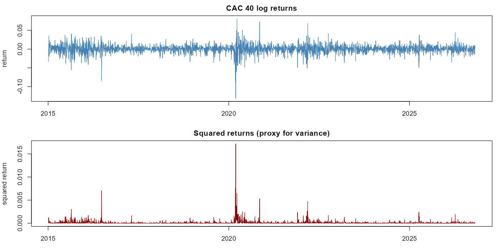
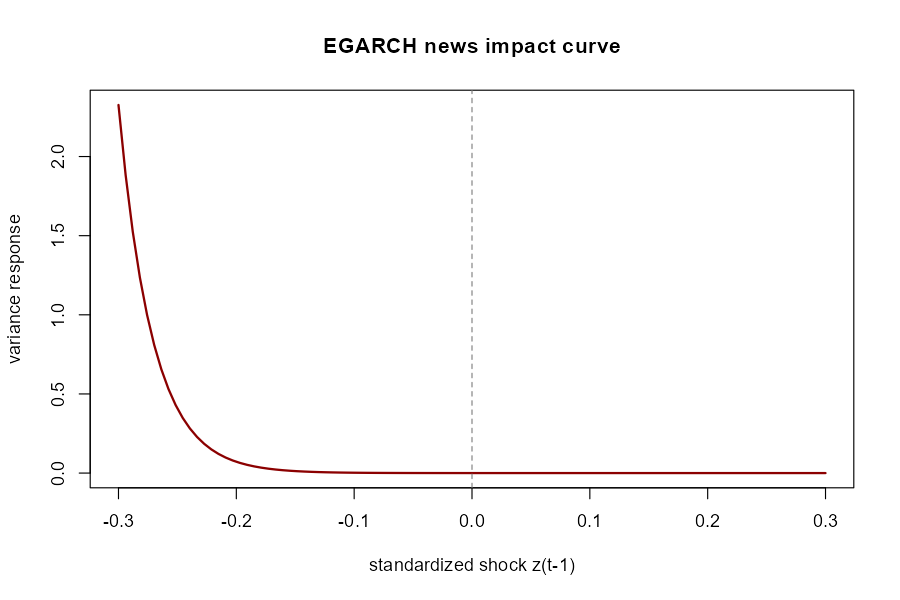
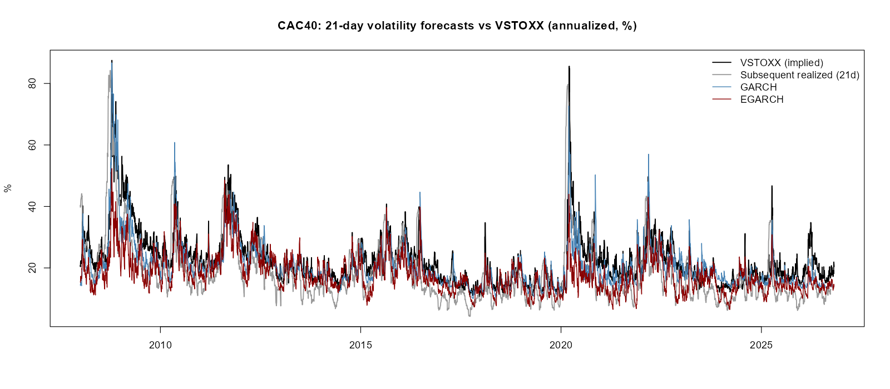
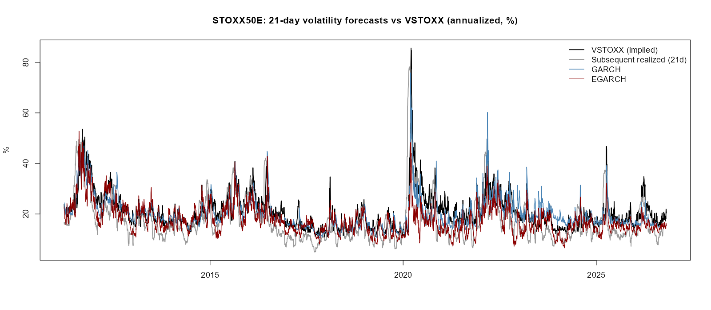
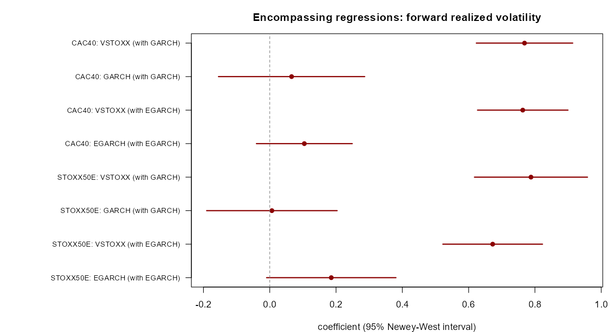
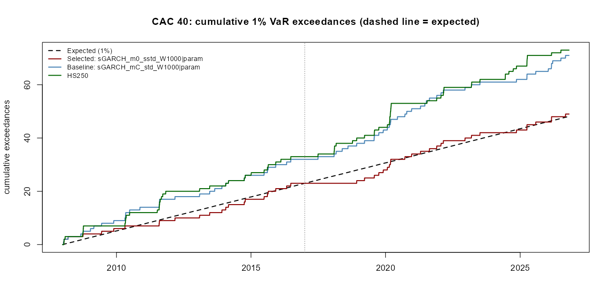

```{r}
#| label: setup
library(knitr)
out <- function(f) file.path("..", "outputs", f)
fig <- function(f) file.path("..", "figures", f)
sci <- function(x, d = 3) formatC(x, format = "g", digits = d)
```

<!-- Numbers written in the text were copied from the outputs when this draft was made.
     Tables and figures are generated from outputs/ and figures/; rerun the R scripts first. -->

# Introduction

Financial returns show volatility clustering and, for equity indices, asymmetric responses to
negative and positive shocks. GARCH-type models are the standard tool for forecasting conditional
volatility and Value-at-Risk. This report asks four questions on the CAC 40 and the EURO STOXX 50:

1. Is there a leverage effect, and does an asymmetric model (EGARCH) fit better than GARCH?
2. Do the models forecast realized volatility as well as the market's implied volatility (VSTOXX)?
3. Do the models contain information that implied volatility does not (encompassing regressions)?
4. Are one-day VaR and Expected Shortfall forecasts well calibrated, and what fixes under-coverage?

[TODO: two or three sentences on contribution and structure, and the literature (see comment at the end).]

# Data

- CAC 40 (`^FCHI`) adjusted close from Yahoo Finance. In-sample analysis and the one-day evaluation use
  2015-01-05 to 2026-10-26 (3,023 returns); the VSTOXX comparison and the VaR work use data from 2000.
- EURO STOXX 50 (`^STOXX50E`), Yahoo Finance, from 2007-04-02.
- VSTOXX (V2TX) daily closes from STOXX, 1999-2026.

Missing prices are dropped, not interpolated. CAC 40 returns (2015-2026) have skewness -0.83 and excess
kurtosis 11.19 (Jarque-Bera p < 2.2e-16); the Ljung-Box test on squared returns rejects at all lags tested.

{#fig-returns}

# Methods

## Models

With $r_t = \mu + \varepsilon_t$, $\varepsilon_t = \sigma_t z_t$ and $z_t$ standardized Student-t:

$$\sigma_t^2 = \omega + \alpha\,\varepsilon_{t-1}^2 + \beta\,\sigma_{t-1}^2 \qquad \text{(GARCH)}$$

$$\ln\sigma_t^2 = \omega + \beta\ln\sigma_{t-1}^2 + \alpha_1 z_{t-1} + \gamma_1\left(|z_{t-1}| - E|z|\right) \qquad \text{(EGARCH, rugarch notation)}$$

Models are estimated by maximum likelihood with `rugarch`. A negative $\alpha_1$ means negative shocks raise
volatility more than positive ones.

## Out-of-sample design

Rolling estimation with a moving window of 1,000 days (2,000 days in the tail experiment), parameters
re-estimated every 50 days. Forecast evaluation uses QLIKE and squared-error losses, Diebold-Mariano tests,
and Newey-West (HAC) variances where forecast windows overlap.

## Comparison with implied volatility

VSTOXX is a 30-calendar-day implied volatility, so model forecasts are averaged over the next 21 trading
days. Realized volatility is measured over the 21 trading days after each forecast origin. The variance
risk premium is VSTOXX minus subsequent realized volatility. Encompassing regressions regress realized
volatility on VSTOXX and a model forecast, with Newey-West standard errors (lag 20, with lag 40 as a check).

## VaR and Expected Shortfall

One-day 1%, 2.5% and 5% VaR and ES. Tests: Kupiec (coverage), Christoffersen (independence), dynamic
quantile, and a McNeil-Frey exceedance-residual test for ES, plus tick loss with Diebold-Mariano tests. A
tail experiment varies the mean (constant or zero), the distribution (Student-t or skewed Student-t), the
window (1,000 or 2,000 days) and the tail estimate (parametric or filtered historical simulation). Candidates
are ranked on 2008-2016 by the mean of |log(exceedance rate / nominal level)| at 1% and 5%, a rule fixed
before running, and reported on 2017-2026, which is not used for selection.

# Results

## In-sample fit

```{r}
#| label: tbl-garch
#| tbl-cap: "GARCH(1,1) with Student-t innovations, CAC 40 2015-2026 (robust standard errors)."
g <- read.csv(out("params_garch.csv"), check.names = FALSE)
kable(g, digits = 4, booktabs = TRUE)
```

```{r}
#| label: tbl-egarch
#| tbl-cap: "EGARCH(1,1) with Student-t innovations, CAC 40 2015-2026 (robust standard errors)."
e <- read.csv(out("params_egarch.csv"), check.names = FALSE)
kable(e, digits = 4, booktabs = TRUE)
```

EGARCH is preferred by AIC (-6.504 vs -6.458), BIC and log-likelihood (9,836 vs 9,766). The leverage term
is negative and significant (@tbl-egarch). Standardized residuals show no remaining autocorrelation or ARCH
effects; the Student-t goodness-of-fit test is rejected.

{#fig-nic}

## One-day out-of-sample forecasts

```{r}
#| label: tbl-oos
#| tbl-cap: "One-day-ahead variance forecasts, CAC 40, last 500 days (squared demeaned return as proxy)."
oos <- read.csv(out("oos_forecasts.csv"))
qlike <- function(r, f) r / f - log(r / f) - 1
dm <- function(l1, l2) { d <- l1 - l2; z <- mean(d) / sqrt(var(d) / length(d)); 2 * pnorm(-abs(z)) }
Lg <- qlike(oos$real, oos$garch); Le <- qlike(oos$real, oos$egarch)
Sg <- (oos$real - oos$garch)^2;   Se <- (oos$real - oos$egarch)^2
kable(data.frame(Loss = c("QLIKE", "MSE"),
                 GARCH = c(sci(mean(Lg), 4), sci(mean(Sg), 4)),
                 EGARCH = c(sci(mean(Le), 4), sci(mean(Se), 4)),
                 `DM p-value` = c(sci(dm(Lg, Le), 2), sci(dm(Sg, Se), 2)),
                 check.names = FALSE), booktabs = TRUE)
```

## Forecasts against VSTOXX

```{r}
#| label: tbl-regime
#| tbl-cap: "CAC 40 21-day forecasts against VSTOXX by regime (vol points). vrp = VSTOXX minus subsequent realized volatility."
reg <- read.csv(out("ext_iv_by_regime_CAC40.csv"))
kable(reg[, c("period", "n", "vrp", "rmse_garch", "rmse_egarch", "rmse_vstoxx")],
      digits = 2, booktabs = TRUE)
```

[TODO: full-sample table (correlations, mean error, RMSE, mean-removed RMSE, Diebold-Mariano with HAC) from
the console output of `R/06_extended_eval.R`; or save that table to a CSV in the script and read it here.]

{#fig-iv-cac}

{#fig-iv-stoxx}

## Encompassing regressions

```{r}
#| label: tbl-enc
#| tbl-cap: "Realized 21-day volatility on VSTOXX and a model forecast (levels, Newey-West lag 20 t-statistics; t40 = lag 40)."
enc <- read.csv(out("encompassing_regressions.csv"))
sub <- subset(enc, scale == "vol" & spec %in% c("4: implied + GARCH", "5: implied + EGARCH") &
                term != "(Intercept)")
kable(sub[, c("dataset", "spec", "term", "est", "t20", "t40", "r2")], digits = 3,
      row.names = FALSE, booktabs = TRUE)
```

VSTOXX remains highly significant when a model forecast is added, while GARCH adds nothing and EGARCH
adds at most a little (@tbl-enc).

{#fig-enc}

## VaR and Expected Shortfall

```{r}
#| label: tbl-var
#| tbl-cap: "One-day VaR backtest, CAC 40, 2008-2026 (Student-t models, constant mean, 1,000-day window)."
v <- read.csv(out("var_backtest_CAC40.csv"))
kable(v[, c("alpha", "model", "exceed", "rate_pct", "kupiec_p", "indep_p", "cc_p", "es_p_less", "tick_x1e4")],
      digits = 3, row.names = FALSE, booktabs = TRUE)
```

```{r}
#| label: tbl-exp
#| tbl-cap: "Tail experiment, hold-out 2017-2026 (candidates not used for selection)."
a <- read.csv(out("var_experiments_all.csv"))
a$candidate <- gsub("\\|", " / ", a$candidate)
keep <- gsub("\\|", " / ", c("sGARCH_mC_std_W1000|param", "sGARCH_m0_sstd_W1000|param",
                              "eGARCH_mC_sstd_W2000|param", "eGARCH_m0_sstd_W2000|param", "HS250"))
h <- subset(a, period == "hold-out 2017-2026" & candidate %in% keep)
kable(h[order(h$alpha), c("alpha", "candidate", "exceed", "rate_pct", "kupiec_p", "dq_p", "es_p_less", "tick_x1e4")],
      digits = 3, row.names = FALSE, booktabs = TRUE)
```

{#fig-cum}

[TODO: three or four sentences: baseline under-covers; skewed-t / longer window bring rates near nominal;
GARCH 1,000 d still fails the dynamic quantile test while the others pass; the selection tie.]

# Limitations

- 21-day windows overlap: about 185 to 227 independent windows per run, so HAC tests may over-reject.
- The 2008-2009 comparison with VSTOXX uses the CAC 40 as a proxy for the EURO STOXX 50.
- Squared returns are a noisy variance proxy; no intraday realized variance is used.
- Implied volatility is risk-neutral, GARCH is physical-measure.
- 33 VaR candidates were evaluated; the selection tie was broken by listing order; the hold-out has about
  25 expected exceedances at 1%.
- Many p-values are reported without multiple-testing adjustment.

# Conclusion

[TODO: five or six sentences. Answer the four questions in order, with the numbers.]

# Reproducibility {.appendix}

Code and data pipeline: scripts `R/01_data.R` to `R/09_encompassing.R`, parameters in `config.yml`,
dependencies locked with `renv`. VSTOXX data downloaded from stoxx.com.

<!-- References to add (verify details before citing): Engle (1982); Bollerslev (1986); Nelson (1991);
     Diebold and Mariano (1995); Newey and West (1987); Kupiec (1995); Christoffersen (1998);
     McNeil and Frey (2000); Engle and Manganelli (2004); Patton (2011) on QLIKE;
     Barone-Adesi, Giannopoulos and Vosper (1999) on filtered historical simulation. -->
